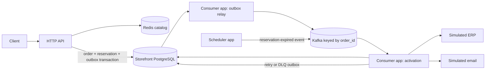

# CaseCellShop

A NestJS storefront with three runnable applications: an HTTP API, a Kafka consumer/outbox relay, and a reservation-expiration scheduler. It demonstrates cached catalog reads, idempotent checkout, atomic stock reservations, bounded activation retries and a DLQ. PostgreSQL belongs to the storefront; ERP invoicing and email are simulated, and the ERP database is never modified.

The five conceptual answers are in [docs/conceptual-answers.md](docs/conceptual-answers.md). [docs/tasks.md](docs/tasks.md) contains the implementation requirements; [PROMPTS.md](PROMPTS.md) records AI assistance and review decisions.

## Table of contents

- [Quick start](#quick-start)
- [Run locally](#run-locally)
- [Try the purchase flow](#try-the-purchase-flow)
- [API and status semantics](#api-and-status-semantics)
- [Architecture and consistency](#architecture-and-consistency)
  - [Checkout and inventory](#checkout-and-inventory)
  - [Activation and recovery](#activation-and-recovery)
  - [Cache policy](#cache-policy)
- [Observability and operations](#observability-and-operations)
  - [Dashboard, alert and query examples](#dashboard-alert-and-query-examples)
  - [Runbooks](#runbooks)
- [Architecture decision: why Apache Kafka?](#architecture-decision-why-apache-kafka)
  - [Trade-offs and how they are handled](#trade-offs-and-how-they-are-handled)
- [Simplifications, trade-offs and limitations](#simplifications-trade-offs-and-limitations)
- [Kafka configuration](#kafka-configuration)
- [Automated tests](#automated-tests)

## Quick start

The fastest path is Docker only (Docker Compose v2 required, no Node.js needed on the host):

```bash
test -f .env || cp .env.example .env
docker compose up -d --build --wait http consumer scheduler
docker compose run --rm migrate npm run seed
```

Compose starts PostgreSQL, Redis, Kafka (a single KRaft broker), initializes topics, runs migrations and starts the three applications. The scheduler has no HTTP server; its health is not exposed as a URL. Once the API and consumer are healthy:

| Service       | URL                                                                      |
| ------------- | ------------------------------------------------------------------------ |
| HTTP API      | [http://localhost:3000](http://localhost:3000)                           |
| Swagger UI    | [http://localhost:3000/api-docs](http://localhost:3000/api-docs)         |
| Worker ops    | [http://localhost:3001/health/ready](http://localhost:3001/health/ready) |
| Kafka UI      | [http://localhost:8080](http://localhost:8080)                           |
| Redis Insight | [http://localhost:5540](http://localhost:5540)                           |

Then follow [Try the purchase flow](#try-the-purchase-flow), or run `npm run test:smoke` / `npm run test:happy-path` (the latter needs the Node.js setup below). Stop everything with `docker compose down` (data volumes are kept; `docker compose down -v` deletes the database, Redis, Kafka and Redis Insight volumes).

## Run locally

Use this path for development with hot reload (the applications run on the host; infrastructure runs in Docker).

Requires Node.js **24.9 or later in the 24.x line**, npm 12.2.2 and Docker Compose v2. Use `nvm use` in each terminal; an existing shell may otherwise continue using another Node version. Jest uses Node's VM modules support for the ESM scheduling package.

```bash
nvm use
npm install --global npm@12.2.2
npm ci
npm run hooks:install
test -f .env || cp .env.example .env
npm run infra:up
npm run infra:init
npm run migration:run
npm run seed
```

`npm run hooks:install` enables the local pre-commit hook for this clone. Every
`git commit` then runs lint, formatting checks, typechecking, the build and unit
tests in that order, stopping and blocking the commit if a check fails. These
checks inspect the current working tree, including unstaged changes. Run
`npm run check` to execute the same checks manually.

Start the applications in separate terminals:

```bash
npm run start:dev
npm run consumer:debug
npm run scheduler:debug
```

Alternatively, start the containers and then seed their database:

```bash
docker compose up -d --build --wait http consumer scheduler
docker compose run --rm migrate npm run seed
```

Kafka UI starts automatically with `npm run infra:up` and when Compose starts `http` or `consumer`. It waits for a healthy Kafka broker and is available at [http://localhost:8080](http://localhost:8080).

Redis Insight, the visual interface for Redis, also starts automatically with `npm run infra:up` and when Compose starts `http` or `consumer`. It waits for a healthy Redis, comes pre-configured with a `CaseCellShop` connection and is available at [http://localhost:5540](http://localhost:5540) (change the host port with `REDIS_INSIGHT_HOST_PORT`). Its settings persist in the `redis-insight-data` volume.

Compose explicitly creates the checkout topic, its DLQ and the `KAFKA_TOPIC` topic (also checked by worker readiness). It applies migrations through a separate job before starting the applications. The API and consumer depend on completed migrations, Redis and Kafka topic initialization. The HTTP application itself does not require Kafka for readiness or checkout: it commits an outbox event to PostgreSQL for later publication. Ports bind to loopback; the API is on 3000 and consumer operations are on 3001. PostgreSQL, Redis and Kafka data survive `docker compose down`.

The seed (`src/database/seeds/seed.ts`) upserts three standard products with 100 initial units each and **does not reset their existing stock** on rerun. Product names are generated reproducibly using Faker seed `42`; IDs, product keys and prices remain fixed. Re-running updates catalog names/prices (integer cents) and invalidates the cache. The exception is `CASE-LIMITED-001`, whose physical stock is reset to one unit, reserved stock to zero, and reservations are deleted on every run. Only run the seed and the scripts below against a disposable/local database: they intentionally reset this product's inventory and reservation records.

With the API and consumer running, `npm run test:overselling` re-seeds and fires five simultaneous checkouts for that single unit. It waits for accepted orders to become `Active` or `Cancelled`, then asserts exactly one active order, four rejected/cancelled requests, no pending order, and zero available/reserved units. It exits `1` on a failed assertion (override the API target with `API_URL`).

For a successful purchase, run `npm run test:happy-path` with the API and consumer running. It re-seeds the same single-unit product, checks `202 Pending`, waits up to 30 seconds for `Active / Completed`, verifies the item prices, consumed reservation, final stock and all four successful activation steps, then checks that replaying the checkout returns the original order without consuming more stock. Failures exit `1`. Use `API_URL` to override the HTTP target; the configured database must belong to those applications. Run it separately from the overselling test because both reset and consume `CASE-LIMITED-001`.

To exercise duplicate Kafka delivery, run `npm run test:duplicate-checkout-event` with the API and consumer running and the integration simulators configured for success. It re-seeds, creates one checkout, reads its original `ORDER_CHECKOUT_INITIATED` outbox payload and publishes that same event three times through Kafka (same order, event ID, attempt and timestamps). After verifying the outcome, it publishes the identical event once more after completion. Each phase waits up to 30 seconds for the application's `${KAFKA_GROUP_ID}-checkout` group to commit past every replay offset before asserting `Active / Completed`, exactly one unit consumed, one consumed reservation, exactly four successful step records, attempt still `1` and no retry/DLQ outbox entries. Failures exit `1`. `API_URL` overrides the HTTP target; database, Kafka brokers, checkout topic and group configuration must match the running applications. Run separately from the happy-path and overselling scripts because all three reset the same product's stock. ERP/email are local simulations; success records do not prove exactly-once effects at a real remote provider.

If ports 3000/3001 are already used by local development, set `API_HOST_PORT=3300 WORKER_HOST_PORT=3301` when running Compose. Run the smoke test with `API_URL=http://localhost:3300 WORKER_URL=http://localhost:3301` in that case.

Application configuration loads `.env.local` before `.env`; environment variables take precedence. `ENV_FILE` selects one explicit application file. The real-service integration tests load `.env.test.example` and optional `.env.test.local` instead; see the test instructions below. Migrations never run automatically at application startup and TypeORM schema synchronization is disabled.

Each app and library has a standard `tsconfig.json` for editor discovery, extending its Nest build configuration. These configurations inherit aliases and decorator settings from the root, including when opening an individual app/library folder. Scripts and tests also have their own editor configurations. If an already-open editor still reports unresolved `@app/*` imports after pulling configuration changes, run **TypeScript: Restart TS Server** from its command palette.

## Try the purchase flow

```bash
curl -s http://localhost:3000/products
curl -i http://localhost:3000/checkout \
  -H 'Content-Type: application/json' \
  -H 'Idempotency-Key: example-purchase-001' \
  -H 'X-Environment: Local' \
  -H 'X-Correlation-Id: 4c79764b-416c-4c29-939c-48eb86649ac3' \
  -d '{"paymentType":"PrePaid","dueDate":"2026-11-10","mainContact":"customer@example.test","paymentMethod":"PIX","items":[{"productId":"11111111-1111-4111-8111-111111111111","quantity":1}]}'
curl -s http://localhost:3000/orders/REPLACE_WITH_ORDER_ID/status
```

Checkout returns `202` and `{ "orderId": "<uuid>", "status": "Pending" }` after the database commit, without waiting for Kafka or ERP. Retry ambiguous HTTP outcomes with the **same key and content**. An identical replay returns the original acceptance response, even if activation has since completed. Changed content under that key returns `409`. Idempotency keys are global to this unauthenticated demonstration and are retained with the order.

Checkout enum values are case-sensitive: `PrePaid`/`PostPaid`, `Local`/`PreProd`/`Prod` (sent in the required `X-Environment` header, not the body), and PascalCase order/processing statuses. Uppercase legacy values are rejected by API validation. The database stores these fields as ordinary `varchar(16)` columns; enum validation stays in the application.

All HTTP fields are camelCase. Database names and checkout event fields are snake_case. Prices are integer cents, not floating-point amounts. The server snapshots current prices; catalog prices are informative, not a binding quote. In a real checkout, add an explicit customer-approved quote/version before charging.

| Endpoint                      | Behavior                                                                                                           |
| ----------------------------- | ------------------------------------------------------------------------------------------------------------------ |
| `GET /products`               | Catalog and prices, without an authoritative stock promise                                                         |
| `POST /checkout`              | Validated purchase with required `Idempotency-Key` and `X-Environment` headers                                     |
| `GET /orders/:orderId/status` | Order state, processing state, items and non-sensitive basic data                                                  |
| `GET /metrics`                | Prometheus metrics on the HTTP API and consumer                                                                    |
| `GET /health/live`            | Process liveness                                                                                                   |
| `GET /health/ready`           | API requires PostgreSQL; consumer additionally requires PostgreSQL, Kafka topic metadata and its checkout consumer |
| `GET /health/cache`           | Optional Redis status on the API and consumer                                                                      |

Errors use `{ statusCode, error, message, correlationId }`: invalid input `400`, missing resources `404`, stock/idempotency conflicts `409`, temporary checkout/catalog failures `503`. Unknown server faults return a sanitized `500`. Missing/invalid correlation UUIDs are replaced and the effective value is echoed in the response header. Contacts are not exposed by order status.

Swagger is at `/api-docs`; JSON at `/api-docs-json`. The committed [OpenAPI document](openapi.json) can be regenerated without infrastructure:

```bash
npm run openapi:export
npx prettier --write openapi.json
```

### API and status semantics

- `POST /checkout` returns `202` only after the order, item price snapshots, stock reservations and initial outbox event commit together. It does not wait for Kafka, ERP invoicing or email.
- A retry with the same `Idempotency-Key` and canonical request returns the original acceptance body, even if the order has since advanced. Poll the status endpoint for current state. Reusing the key with changed request content returns `409`.
- `status` describes the inventory/order lifecycle: `Pending`, `Active` or `Cancelled`. `processingStatus` describes async work: `Pending`, `Processing`, `Retrying`, `Completed` or `Failed`. `Active` means stock was consumed, not that invoicing or email succeeded.
- The checkout status endpoint returns item snapshots and non-sensitive order data; it does not expose customer contact fields. This demonstration has no authentication, and its idempotency key namespace is global.

## Architecture and consistency



`libs/orders` owns checkout, order queries, activation, retries and the transactional outbox. `libs/products` owns the catalog and, in its `inventory` sub-module, stock and reservations; the inventory module exports reservation operations without importing Orders. Both libraries use feature-oriented domain, adapter and repository boundaries.

`apps/http` serves the public API. `apps/consumer` runs the checkout Kafka consumer, outbox relay and an operations HTTP server in the `${KAFKA_GROUP_ID}-checkout` group. `apps/scheduler` is a separate process with no HTTP server; it finds expired pending reservations and publishes expiration events but does not mutate orders or stock. The consumer handles those events and performs the transactional cancellation and release. The HTTP module imports neither consumer nor scheduler. Event schemas live in `libs/orders/src/messaging` and are independent of HTTP and ORM. `libs/platform` supplies shared connections, validated configuration, logging, metrics and trace-context utilities. These are three independently runnable applications sharing a storefront-owned database, not three independently owned microservices.

### Checkout and inventory

A single transaction creates the order, immutable item prices, stock reservations and initial outbox event. PostgreSQL's unique idempotency key serializes concurrent replays. Canonical hashing ignores item/object property order but includes all purchase fields.

Stock is reserved with `UPDATE ... WHERE physical_quantity - reserved_quantity >= quantity`. Products are processed in stable ID order. Failure of any item rolls back the entire purchase. Database checks prohibit negative quantities and reservations above physical stock; uniqueness prevents duplicate product rows per order. UUIDs identify all domain records.

Reservations last 900 seconds by default. The example has no payment gateway: checkout authorizes immediate processing. `PrePaid`, `PostPaid`, payment method and due date are metadata; they do not prove an actual payment.

### Activation and recovery

The exact step order is:

1. `ConsumeStockReservationStep`.
2. `ActivateOrderStep`.
3. `UpdateErpStep`.
4. `EmailNotificationStep`.

Consumption, activation and both success records commit together. Order/reservation rows are locked and expiration uses PostgreSQL time. Physical and reserved quantities decrease together. A dedicated PostgreSQL advisory lock serializes activations of the same order; external calls happen outside transactions.

`Active` means stock was consumed. It does **not** promise successful invoicing. `processingStatus` reports `Pending`, `Processing`, `Retrying`, `Completed` or `Failed`. Success records are unique per order/action/step, so subsequent attempts resume at unfinished steps. Failure of ERP/email keeps the order active and does not replenish stock.

A failed attempt atomically records the failure, processing state and next outbox entry. There are at most five attempts, separated by 1, 2, 4 and 8 seconds plus relay/broker latency. Permanent errors and exhausted attempts create a DLQ outbox entry. A terminal failure before consumption releases the reservation and cancels the pending order. Infrastructure failures while recording outcomes propagate to the Nest Kafka transport and prevent offset advancement. The order handler sends heartbeats while processing; Kafka redelivers failed messages after recovery.

The relay runs every second. It claims up to 20 rows with `SKIP LOCKED` and a 30-second lease, publishes with `acks=-1` and `order_id` as key, then marks them processed only when its lease token still matches. Expired leases can be reclaimed. Crashing after Kafka acknowledgment but before the database update can duplicate publication; consumers must remain idempotent. A log statement alone does not implement retries or DLQ delivery.

The Kafka consumer validates each incoming message before passing the typed event to the use case. A global exception filter sends unhandled permanent or unexpected processing errors to the DLQ with the validated event and headers for kind, error type, reason and source topic/partition/offset. Recognized transient database/network codes, Kafka errors and timeouts remain eligible for broker redelivery; a failed DLQ publication also prevents offset advancement. Unclassified errors are treated as unexpected and sent to the DLQ. Activation-step retries and terminal DLQ events still use the transactional outbox.

Malformed events are sent to the DLQ with their recognized kind, source topic/partition/offset and a reason, not their arbitrary raw payload. Original Kafka records remain the source for investigation, subject to broker retention. Direct DLQ publication can be duplicated if the process stops before its offset is committed. An unexpected error outside the activation failure workflow can leave the order `Pending` or `Processing`; investigate and recover it using the runbook. The filter handles Kafka handler exceptions, not process crashes, startup failures or errors before the transport invokes a handler.

Reservation expiry is split between two apps. The separate `scheduler` app (no HTTP server) polls every `SCHEDULER_INTERVAL_MS` (default 10 seconds, with no overlapping cycles) for up to 50 `Pending` orders with expired active reservations, oldest `expires_at` first. It publishes `ORDER_RESERVATION_EXPIRED` events keyed by `order_id`; it never changes orders or stock. The consumer's `ReservationExpiredHandler` takes the same per-order advisory lock as activation, skips completed or already-processed orders, and transactionally cancels the pending order and releases its active reservations. Duplicate expiration events are safe. After commit the consumer invalidates `storefront:products`; Redis failure is logged and does not undo the committed stock release. Concurrent expiry and activation cannot both consume and release the same reservation.

ERP/email calls are bounded local simulations that log stable `orderId:integration` keys; the simulator does not contact a provider or enforce provider-side idempotency. Logs may repeat if a process crashes before recording success. A real remote system must honor idempotency keys or support lookup/reconciliation; this implementation makes no exactly-once remote-effect claim.

### Cache policy

`storefront:products` has a 300-second TTL. Cache-aside combines a per-process promise with a Redis `SET NX PX` lock. Other instances wait for the populated cache. Publication and release verify the owner's token, preventing an expired owner from overwriting a later result. The lock expires after five seconds; callers stop waiting after six seconds and receive `503`.

Malformed cache contents are treated as misses. Redis command failures fall back to PostgreSQL with local single-flight. During a Redis outage, separate API replicas can each load the database; there is no cross-process protection without Redis. The seed invalidates both cache and lock after committing; reservation expiry invalidates the catalog after releasing stock. There is no durable invalidation queue or administrative catalog mutation API. If seed invalidation fails after commit, the seed exits with an error and should be retried; TTL bounds old data meanwhile. If expiry invalidation fails, the consumer logs it and the cache can retain an old catalog until TTL.

Availability is checked exclusively in the checkout transaction. Storefront-owned stock prevents overselling only within its allocated inventory. Selling the same stock through an independent ERP channel requires an allocation/reservation agreement and reconciliation; a cache cannot provide that guarantee.

## Observability and operations

Pino writes JSON to stdout with app, level, event message, correlation, order and trace context when applicable. Log and trace context keys are snake_case (`correlation_id`, `order_id`, `trace_id`, `span_id`, `parent_span_id`). Purchase/contact payloads and credentials are not included in operational logs. The audit interceptor redacts sensitive fields and asynchronously persists mutation requests through a bounded 1,000-entry queue. Audit persistence errors/overflow are counted and do not fail checkout. The queue drains on graceful shutdown, but abrupt termination can lose unflushed audit records; it is not a compliance ledger.

Structured `trace.span` logs connect catalog loading, checkout transactions, relay publication and activation steps. They carry trace/span/parent identifiers and duration; events carry the custom trace identifiers and correlation ID. **This is a local tracing simulation**, not an OpenTelemetry or Datadog exporter, and it does not extract/inject W3C `traceparent` context. Replace it with instrumented spans and standard propagation before relying on distributed trace tooling.

Metrics avoid correlation/order/product IDs in labels:

- `shop_cache_requests_total{result}`: hit, miss, invalid, unavailable.
- `shop_checkout_total{result}`: accepted, replayed, rejected.
- `shop_reservations_total{result}`: reservation transitions.
- `shop_processing_total{result}`: completed, retry, DLQ, invalid DLQ, published.
- `shop_step_duration_seconds{step,result}`, `shop_http_duration_seconds{method,route,status}`.
- `shop_outbox_pending`, `shop_outbox_oldest_seconds`.
- `shop_request_log_total{result}`: saved, failed, dropped.

Scrape the HTTP API and consumer separately; the scheduler has no metrics HTTP endpoint. Outbox gauges are refreshed by the relay against the shared database; use `max`, not `sum`, across consumer replicas. The pending-event age includes future-scheduled retries, so it is not by itself a measure of overdue work. Kafka consumer lag and actual inventory discrepancies need broker/database monitoring outside this compact service.

Suggested initial objectives, to validate under representative load: 99.9% eligible HTTP requests succeed over 30 days; successful catalog p95 <200 ms; accepted checkout p95 <300 ms; 99% of accepted orders reach completed processing within 60 seconds over 30 days, including dependency incidents; overselling and duplicate invoices remain zero. Business rejections are excluded from availability failures but measured separately. These are proposed targets, not benchmark results; the current metrics do not yet measure the async completion SLI.

A Datadog/Prometheus dashboard should compare endpoint latency/error rate, cache hit ratio and fallback count, accepted purchases versus worker completions, outbox age/backlog, retry/DLQ rate and ERP duration. Alert on DLQ arrivals, sustained HTTP 5xx, audit drops and growing **due** outbox age. The current pending-age gauge also includes scheduled retry events, so add a due-event-age metric before using it as a page threshold. Stock invariant and ERP invoice discrepancy alerts require a reconciliation process and metrics, neither of which is implemented. Pair long-window SLO burn with a short-window alert before paging on latency alone.

### Dashboard, alert and query examples

Prometheus queries (Datadog uses the same metric names through its OpenMetrics check):

| Panel / alert                                     | Query                                                                                                                      |
| ------------------------------------------------- | -------------------------------------------------------------------------------------------------------------------------- |
| Cache hit ratio                                   | `sum(rate(shop_cache_requests_total{result="hit"}[5m])) / sum(rate(shop_cache_requests_total{result=~"hit\|miss"}[5m]))`   |
| Catalog p95 latency                               | `histogram_quantile(0.95, sum by (le) (rate(shop_http_duration_seconds_bucket{route="/products"}[5m])))`                   |
| Checkout p95 latency                              | `histogram_quantile(0.95, sum by (le) (rate(shop_http_duration_seconds_bucket{route="/checkout"}[5m])))`                   |
| HTTP 5xx ratio                                    | `sum(rate(shop_http_duration_seconds_count{status=~"5.."}[5m])) / sum(rate(shop_http_duration_seconds_count[5m]))`         |
| Accepted vs. completed                            | `sum(rate(shop_checkout_total{result="accepted"}[5m]))` against `sum(rate(shop_processing_total{result="completed"}[5m]))` |
| Retry / DLQ rate                                  | `sum(rate(shop_processing_total{result=~"retry\|dlq\|invalid_dlq"}[5m]))`                                                  |
| Oldest pending event (includes scheduled retries) | `max(shop_outbox_oldest_seconds)`                                                                                          |
| ERP step p95                                      | `histogram_quantile(0.95, sum by (le) (rate(shop_step_duration_seconds_bucket{step="UpdateErpStep"}[5m])))`                |

Example monitors: `increase(shop_processing_total{result=~"dlq|invalid_dlq"}[5m]) > 0` (page); 5xx ratio `> 0.01` for 5 minutes with sufficient traffic (page); cache hit ratio `< 0.8` for 15 minutes (ticket). Add an overdue-outbox alert only after exposing a gauge that excludes future-scheduled retries; `shop_outbox_oldest_seconds` alone includes those events. Suggested dashboard rows: _Customer funnel_ (accepted to completed, latency), _Catalog cache_ (hit ratio, unavailable fallbacks), _Async pipeline_ (outbox age, retries, DLQ, ERP p95) and _Inventory_ (reservation transitions, rejections; a reconciliation signal must be added before discrepancy alerting).

To measure the cache benefit, compare `GET /products` p95 and database load with Redis up and stopped (for example with `autocannon`). No benchmark results are recorded here; the targets above are proposals.

### Runbooks

**Slow catalog:** compare cache hit/miss/unavailable rates and database latency; check `/health/cache`, Redis connectivity and the lock TTL. Do not delete a live owner's lock arbitrarily. Scale database fallback capacity or shed load during Redis outages. Never serve cached availability as a checkout guarantee.

**Pending order/backlog:** search by order/correlation ID; check worker readiness, Kafka topics, database connectivity and pending outbox age. Restore dependencies and let pending rows/expired leases resume. Do not manually mark pending events processed to silence the alert.

**Retry or DLQ:** inspect the failed step and sanitized `idempotency_log.reference`. Fix the cause first. Re-delivering the same valid event safely retries unrecorded work, but already-recorded attempts and terminal orders are intentionally ignored. A malformed event requires a corrected schema and a valid matching order/attempt. Never blindly send a DLQ envelope to the checkout topic.

**Terminal active order:** verify invoice/email state using the stable provider key before any manual action. Complete missing remote work with that key, then record its verified success through a reviewed database transaction and mark processing complete only after all four success records exist. Preserve successful steps and stock history. There is deliberately no automatic terminal-reset endpoint: creating a new retry cycle requires an explicit administrative design, not resetting `last_attempt` in isolation.

**Inventory and invoice reconciliation:** no automated stock-drift or ERP invoice reconciliation job is implemented. The expiration scheduler only finds expired pending reservations; the consumer cancels eligible orders and releases their local reservations. For an operational discrepancy, compare each stock row's `reserved_quantity` with the sum of ACTIVE reservations and compare consumed quantities with accepted orders. Check invoice state by stable order/provider key before retrying or changing local state. For Failed active orders, compensation/restocking requires a business decision and proof that fulfillment did not occur.

## Architecture decision: why Apache Kafka?

**Status:** accepted. Apache Kafka was chosen deliberately over traditional queue-oriented brokers (RabbitMQ, SQS) for keyed partition ordering, retained-event history, independent consumer groups and burst buffering. Observability still comes from application logs, metrics and tracing instrumentation; Kafka alone does not provide end-to-end order visibility.

1. **Per-aggregate partitioning (`order_id` as message key).** Checkout, retry and expiration events use `order_id` as their Kafka key, so records for one order route to the same partition and preserve their publication order within that partition. This is not a guarantee of logical lifecycle order: delayed outbox retries and scheduler-published expiry events can interleave. Database state transitions, row locks and the per-order advisory lock enforce the business invariants.
2. **Retained log and replay potential.** Kafka retains records according to broker/topic retention configuration; retention is not a replay tool by itself. Schema-valid events sent directly to the `.dlq` topic retain the event payload and carry error/source metadata in headers. Malformed messages carry only a recognized kind, source coordinates and a reason, never arbitrary raw payload. The application has no automated DLQ replay tool, and retention/replay behavior must be configured and operated deliberately (see [Activation and recovery](#activation-and-recovery)).
3. **Decoupling from future consumers.** Independent consumer groups can read the same event stream (`{ kind, data, meta }`). New services (audit, analytics, notifications, anti-fraud) can subscribe to the orders topic later without changing the existing producers (`http` or `scheduler`).
4. **Buffering bursts.** When checkout spikes meet slow integrations, Kafka buffers events published by the transactional outbox relay so workers can process them at a sustainable rate. HTTP acceptance is decoupled from Kafka/ERP availability after the database commit, but PostgreSQL capacity remains on the checkout path and still limits accepted throughput.

### Trade-offs and how they are handled

Kafka has no native per-message delayed delivery and no automatic per-event retry with backoff. Sleeping inside the consumer would block its partition, so this project combines Kafka with the **transactional outbox** and the separate **scheduler**:

- A failed activation attempt writes the next attempt to the outbox in the same transaction as its failure record, with a delay of `2 ** (attempt - 1)` seconds (1, 2, 4 and 8 s) stored in `available_at`. The relay publishes rows only after `available_at`; it does not sleep inside a Kafka handler.
- Terminal failures are written to the outbox for `<checkout topic>.dlq` the same way.
- Reservation expiry is driven by the scheduler, which republishes `ORDER_RESERVATION_EXPIRED` until the order is handled; handlers are idempotent.
- Costs accepted in exchange: higher operational weight than a simple queue (broker, partitions, consumer groups, offsets), at-least-once delivery that requires idempotent consumers, and publication ordering only within a partition (hence the `order_id` key). The local setup uses one broker, three partitions per topic and replication factor one; it has no broker HA.

## Simplifications, trade-offs and limitations

- **ERP and email are simulations.** Real invoicing needs provider idempotency keys or lookup and an ERP reconciliation job; neither exists here.
- **Stock is storefront-owned.** No overselling is guaranteed only for the inventory allocated to this database. Selling the same units through the ERP or another channel needs an allocation agreement.
- **Catalog freshness is TTL-bounded (300 s)** plus invalidation after seeds and expirations. Prices are snapshotted at checkout without a customer-approved quote.
- **Tracing is a log-based simulation** (`trace.span`); event metadata carries custom trace IDs, but there is no OpenTelemetry/Datadog exporter or W3C `traceparent` propagation.
- **No authentication or rate limiting.** Idempotency keys are global; production needs per-customer scoping.
- **Payments are metadata only.** `PrePaid`/`PostPaid` do not call a gateway.
- **Single PostgreSQL, Kafka broker and Redis**, with no HA or DR exercises. Hot products serialize on their stock row.
- **No automated stock-drift or ERP invoice reconciliation, and no DLQ replay tool.** The expiration scheduler only finds expired pending reservations; the consumer handles their cancellation/release.
- **No benchmark or SLO validation** was performed.
- The trade-offs behind the outbox, reservations and cache-aside choices are in [docs/conceptual-answers.md](docs/conceptual-answers.md).

## Kafka configuration

Kafka uses `@nestjs/microservices` (`ClientKafka` and `@EventPattern`) and logging uses `nestjs-pino`. Brokers and topics come from shared validated configuration. All three applications run without SASL in the local setup. Optional `KAFKA_SSL`, `KAFKA_SASL_MECHANISM`, `KAFKA_SASL_USERNAME` and `KAFKA_SASL_PASSWORD` configure authentication centrally for the Kafka producer, consumer and metadata checks. Supported mechanisms are `plain`, `scram-sha-256` and `scram-sha-512`; all three SASL fields must be supplied together. Credentials are not logged. `API_PORT` and `WORKER_PORT` configure the API and consumer operations server; the scheduler has no port.

With the pinned KafkaJS 2.2.4 dependency, Node.js 24 may report a `TimeoutNegativeWarning` for a negative request-queue timeout and clamp it to 1 ms. The warning is treated as harmless in this setup; production start scripts and Compose suppress only that warning with `--disable-warning=TimeoutNegativeWarning`.

## Automated tests

The real-service integration tests require Docker, a local PostgreSQL test database and a local Kafka broker. To start only those dependencies using this repository's Compose configuration:

```bash
docker compose up -d --wait postgres kafka
test -f .env.test.local || cp .env.test.example .env.test.local
npm run test:integration
```

The tests load `.env.test.example`, then optional `.env.test.local`; explicit `DATABASE_URL` and `KAFKA_BROKERS` environment variables take precedence. Application `.env` files are not loaded. Preserve an existing `.env.test.local` if it already has your test settings. Simulator behavior and reservation TTL are fixed by the tests. PostgreSQL and Kafka must be on loopback, and the database name must end in `_test`. If an existing Compose volume lacks the test database, create it once with `docker compose exec postgres createdb -U casecellshop casecellshop_test`.

Each real-service test applies the official migrations in a uniquely named schema, creates its own Kafka topics and groups, and starts a disposable Redis container on an ephemeral loopback port. Docker needs the `redis:7.4.6-bookworm` image locally or permission to pull it. Teardown closes consumers and removes only those owned resources; it does not truncate shared tables, flush shared Redis, or stop existing PostgreSQL/Kafka containers. For a focused run:

```bash
npm run test:integration -- --runTestsByPath test/integration/real-messaging.integration.spec.ts --detectOpenHandles
```

The tests cover the HTTP/OpenAPI contract, audit redaction and metrics, catalog TTL/stampede/fallback, 20 concurrent buyers for five units, idempotency and transaction rollback, real Kafka delivery and duplicate processing, retry/backoff/DLQ, outbox recovery, and reservation expiration. Four earlier integration files still use in-memory adapters; their real-service counterparts are the `real-*` suites and the scheduler suite.

The test applications run the real Nest modules in the Jest process; they do not prove container startup or multi-host performance. Scheduler and relay cycles are invoked explicitly. ERP and email are simulations, and some failure paths use controlled adapter faults; only the disposable Redis container is stopped to test an actual outage. Trace spans are log stubs, and no production SLO or real ERP reconciliation is verified. See [docs/verification.md](docs/verification.md) for the coverage and limitations.

Other checks are `npm test`, `npm run typecheck`, `npm run lint`, `npm run format:check` and `npm run build`.
