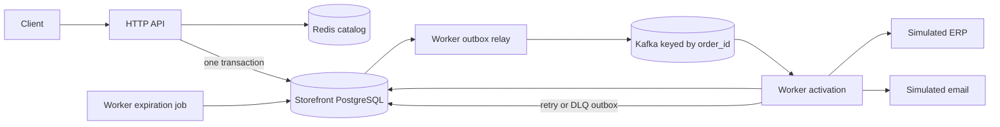

# CaseCellShop

A NestJS storefront API and Kafka worker implementing cached catalog reads, idempotent checkout, atomic stock reservations, a transactional outbox, bounded activation retries and a DLQ. PostgreSQL belongs to the storefront; the ERP is simulated and its database is never modified.

The five conceptual answers are in [docs/conceptual-answers.md](docs/conceptual-answers.md). [docs/tasks.md](docs/tasks.md) contains the implementation requirements; [PROMPTS.md](PROMPTS.md) records AI assistance and review decisions.

## Run locally

Requires Node.js **24.9 or later in the 24.x line**, npm 12.2.2 and Docker Compose v2. Use `nvm use` in each terminal; an existing shell may otherwise continue using Node 20. Jest uses Node's VM modules support for the ESM scheduling package.

```bash
nvm use
npm install --global npm@12.2.2
npm ci
cp .env.example .env
npm run infra:up
npm run infra:init
npm run migration:run
npm run seed
```

Start the applications in separate terminals:

```bash
npm run start:dev
npm run consumer:debug
```

Alternatively, start the containers and then seed their database:

```bash
docker compose up -d --build --wait http consumer
docker compose run --rm migrate npm run seed
```

Kafka UI starts automatically with `npm run infra:up` and when Compose starts `http` or `consumer`. It waits for a healthy Kafka broker and is available at [http://localhost:8080](http://localhost:8080).

Compose creates the demo, checkout and DLQ topics explicitly. It applies migrations through a separate job before starting the applications. Both the API and the worker wait for PostgreSQL migrations, a healthy Redis and Kafka topic initialization. Ports bind to loopback; API is on 3000 and worker operations on 3001. PostgreSQL, Redis and Kafka data survive `docker compose down`. The seed (`src/database/seeds/seed.ts`) creates three products with 100 units each and **never resets existing stock** for them. Product names combine phone-case styles, phone models and colors using Faker with a fixed seed (`42`); the pinned Faker version and generation order keep names reproducible across runs. IDs, product keys and prices remain fixed. Re-running it updates catalog names/prices (integer cents) and invalidates the cache. The one exception is the flash-sale product `CASE-LIMITED-001`, whose stock is reset to 1 unit (0 reserved) and its reservations are cleared on every run.

With the API and consumer running, `npm run test:overselling` re-seeds and fires 5 simultaneous checkouts for that single unit. It prints a summary and exits `1` if more than one order is activated, stock goes negative or an order stays `Pending` (override the target with `API_URL`).

For a successful purchase, run `npm run test:happy-path` with the API and consumer running. It re-seeds the same single-unit product, checks `202 Pending`, waits up to 30 seconds for `Active / Completed`, verifies the item prices, consumed reservation, final stock and all four successful activation steps, then checks that replaying the checkout returns the original order without consuming more stock. Failures exit `1`. Use `API_URL` to override the HTTP target; the configured database must belong to those applications. Run it separately from the overselling test because both reset and consume `CASE-LIMITED-001`.

If ports 3000/3001 are already used by local development, set `API_HOST_PORT=3300 WORKER_HOST_PORT=3301` when running Compose. Run the smoke test with `API_URL=http://localhost:3300 WORKER_URL=http://localhost:3301` in that case.

Configuration loads `.env.local` before `.env`; environment variables take precedence. `ENV_FILE` selects one explicit file. Tests use only `.env.test.local` or `TEST_ENV_FILE`. Migrations never run automatically at application startup and TypeORM schema synchronization is disabled.

Each app and library has a standard `tsconfig.json` for editor discovery, extending its Nest build configuration. These configurations inherit aliases and decorator settings from the root, including when opening an individual app/library folder. Scripts and tests also have their own editor configurations. If an already-open editor still reports unresolved `@app/*` imports after pulling configuration changes, run **TypeScript: Restart TS Server** from its command palette.

## Try the purchase flow

```bash
curl -s http://localhost:3000/products
curl -i http://localhost:3000/checkout \
  -H 'Content-Type: application/json' \
  -H 'Idempotency-Key: example-purchase-001' \
  -H 'x-correlation-id: 4c79764b-416c-4c29-939c-48eb86649ac3' \
  -d '{"paymentType":"PrePaid","dueDate":"2026-11-10","mainContact":"customer@example.test","paymentMethod":"PIX","environment":"Local","items":[{"productId":"11111111-1111-4111-8111-111111111111","quantity":1}]}'
curl -s http://localhost:3000/orders/REPLACE_WITH_ORDER_ID/status
```

Checkout returns `202` and `{ "orderId": "<uuid>", "status": "Pending" }` after the database commit, without waiting for Kafka or ERP. Retry ambiguous HTTP outcomes with the **same key and content**. An identical replay returns the original acceptance response, even if activation has since completed. Changed content under that key returns `409`. Idempotency keys are global to this unauthenticated demonstration and are retained with the order.

Checkout enum values are case-sensitive: `PrePaid`/`PostPaid`, `Local`/`PreProd`/`Prod`, and PascalCase order/processing statuses. Uppercase legacy values are rejected by API validation. The database stores these fields as ordinary `varchar(16)` columns; enum validation stays in the application. The migration history was rebuilt from scratch (parent tables first, child tables with named foreign keys and indexed FK columns); an installation created from the previous history must be recreated (drop the schema, then `npm run migration:run`). Existing idempotency hashes retain the original request representation; retrying a pre-upgrade key with PascalCase content returns `409`.

All HTTP fields are camelCase. Database names and checkout event fields are snake_case. Prices are decimal strings, not floating-point numbers. The server snapshots current prices; catalog prices are informative, not a binding quote. In a real checkout, add an explicit customer-approved quote/version before charging.

| Endpoint                      | Behavior                                                                       |
| ----------------------------- | ------------------------------------------------------------------------------ |
| `GET /products`               | Catalog and prices, without an authoritative stock promise                     |
| `POST /checkout`              | Validated purchase with required `Idempotency-Key`                             |
| `GET /orders/:orderId/status` | Order state, processing state, items and non-sensitive basic data              |
| `GET /metrics`                | Prometheus metrics on both applications                                        |
| `GET /health/live`            | Process liveness                                                               |
| `GET /health/ready`           | API requires PostgreSQL; worker additionally requires Kafka and both consumers |
| `GET /health/cache`           | Optional Redis dependency status                                               |

Errors use `{ statusCode, error, message, correlationId }`: invalid input `400`, missing resources `404`, stock/idempotency conflicts `409`, temporary checkout/catalog failures `503`. Unknown server faults return a sanitized `500`. Missing/invalid correlation UUIDs are replaced and the effective value is echoed in the response header. Contacts are not exposed by order status.

Swagger is at `/api-docs`; JSON at `/api-docs-json`. The committed [OpenAPI document](openapi.json) can be regenerated without infrastructure:

```bash
npm run openapi:export
npx prettier --write openapi.json
```

The original `/demo/messages` POST/GET endpoints remain available. Unlike checkout, the demo publisher waits for a Kafka acknowledgment and does not implement HTTP idempotency.

## Architecture and consistency



`libs/order` owns checkout, order queries, activation, retries, the transactional outbox and expiration orchestration. `libs/shop` owns catalog and inventory; its inventory module exports reservation operations without importing Orders. Feature controllers live with their modules. `apps/http` serves the public API, while `apps/consumer` runs two Nest Kafka transports (preserving the demo group and the `-checkout` group), scheduled jobs and an operations HTTP server. HTTP imports no consumer or scheduler module. Shared contracts are independent of HTTP and ORM. `libs/platform` supplies connections, validated configuration, logging, metrics and tracing simulation. This is one storefront-owned database and two independently runnable applications, not separately owned microservices.

### Checkout and inventory

A single transaction creates the order, immutable item prices, stock reservations and initial outbox event. PostgreSQL's unique idempotency key serializes concurrent replays. Canonical hashing ignores item/object property order but includes all purchase fields.

Stock is reserved with `UPDATE ... WHERE physical_quantity - reserved_quantity >= quantity`. Products are processed in stable ID order. Failure of any item rolls back the entire purchase. Database checks prohibit negative quantities and reservations above physical stock; uniqueness prevents duplicate product rows per order. UUIDs identify all domain records.

Reservations last 900 seconds by default. The example has no payment gateway: checkout authorizes immediate processing. `PrePaid`, `PostPaid`, payment method and due date are metadata; they do not prove an actual payment.

### Activation and recovery

The exact step order is:

1. `ConsumeStockReservationStep`.
2. `ActivateOrderStep`.
3. `UpdateErpStep`.
4. `EmailNotificationStep`.

Consumption, activation and both success records commit together. Order/reservation rows are locked and expiration uses PostgreSQL time. Physical and reserved quantities decrease together. A dedicated PostgreSQL advisory lock serializes activations of the same order; external calls happen outside transactions.

`Active` means stock was consumed. It does **not** promise successful invoicing. `processingStatus` reports `Pending`, `Processing`, `Retrying`, `Completed` or `Failed`. Success records are unique per order/action/step, so subsequent attempts resume at unfinished steps. Failure of ERP/email keeps the order active and does not replenish stock.

A failed attempt atomically records the failure, processing state and next outbox entry. There are at most five attempts, separated by 1, 2, 4 and 8 seconds plus relay/broker latency. Permanent errors and exhausted attempts create a DLQ outbox entry. A terminal failure before consumption releases the reservation and cancels the pending order. Infrastructure failures while recording outcomes propagate to the Nest Kafka transport and prevent offset advancement. The order handler sends heartbeats while processing; Kafka redelivers failed messages after recovery.

The relay runs every second. It claims up to 20 rows with `SKIP LOCKED` and a 30-second lease, publishes with `acks=-1` and `order_id` as key, then marks them processed only when its lease token still matches. Expired leases can be reclaimed. Crashing after Kafka acknowledgment but before the database update can duplicate publication; consumers must remain idempotent. A log statement alone does not implement retries or DLQ delivery.

Malformed events are sent to the DLQ before completing their handler. Their DLQ record contains source topic/partition/offset and a reason, not an arbitrary raw payload. Original Kafka records remain the source for investigation, subject to broker retention.

Every five minutes, cleanup selects up to 1,000 expired active reservations, then handles all reservations for each selected order. It locks the order first, uses stable product order and releases each active reservation once. It never cancels an active order. Concurrent cleanup/activation cannot both consume and release the same stock.

ERP/email calls are bounded local simulations with stable `orderId:integration` keys. Logs may repeat if a process crashes before recording success. A real remote system must honor idempotency keys or support lookup/reconciliation; this implementation makes no exactly-once remote-effect claim.

### Cache policy

`storefront:products` has a 300-second TTL. Cache-aside combines a per-process promise with a Redis `SET NX PX` lock. Other instances wait for the populated cache. Publication and release verify the owner's token, preventing an expired owner from overwriting a later result. The lock expires after five seconds; callers stop waiting after six seconds and receive `503`.

Malformed cache contents are treated as misses. Redis command failures fall back to PostgreSQL with local single-flight. During a Redis outage, separate API replicas can each load the database; there is no cross-process protection without Redis. The seed invalidates both cache and lock after committing. If invalidation fails after commit, retry it; the TTL bounds old data meanwhile. No administrative catalog mutation API is exposed.

Availability is checked exclusively in the checkout transaction. Storefront-owned stock prevents overselling only within its allocated inventory. Selling the same stock through an independent ERP channel requires an allocation/reservation agreement and reconciliation; a cache cannot provide that guarantee.

## Observability and operations

Pino writes JSON to stdout with app, level, event message, correlation, order and trace context when applicable. Existing demo logs retain their original camelCase identifiers. Purchase/contact payloads and credentials are not included in operational logs. The audit interceptor redacts sensitive fields and asynchronously persists mutation requests through a bounded 1,000-entry queue. Audit persistence errors/overflow are counted and do not fail checkout. The queue drains on graceful shutdown, but abrupt termination can lose unflushed audit records; it is not a compliance ledger.

Structured `trace.span` logs connect catalog loading, checkout transactions, relay publication and activation steps. They carry trace/span/parent identifiers and duration. **This is a local tracing simulation**, not an OpenTelemetry or Datadog exporter. Replace it with instrumented spans and W3C propagation before relying on distributed trace tooling.

Metrics avoid correlation/order/product IDs in labels:

- `shop_cache_requests_total{result}`: hit, miss, invalid, unavailable.
- `shop_checkout_total{result}`: accepted, replayed, rejected.
- `shop_reservations_total{result}`: reservation transitions.
- `shop_processing_total{result}`: completed, retry, DLQ, invalid DLQ, published.
- `shop_step_duration_seconds{step,result}`, `shop_http_duration_seconds{method,route,status}`.
- `shop_outbox_pending`, `shop_outbox_oldest_seconds`.
- `shop_request_log_total{result}`: saved, failed, dropped.

Scrape both applications separately. Outbox gauges describe the shared database; use `max`, not `sum`, across workers. Kafka consumer lag and actual inventory discrepancies need broker/database monitoring outside this compact service.

Suggested initial objectives, to validate under representative load: 99.9% valid HTTP requests succeed over 30 days; cached catalog p95 <200 ms; accepted checkout p95 <300 ms; 99% of accepted orders reach completed processing within 60 seconds when dependencies are healthy; overselling remains zero. Business rejections are excluded from availability failures but measured separately. These are proposed targets, not benchmark results.

A Datadog/Prometheus dashboard should compare endpoint latency/error rate, cache hit ratio and fallback count, accepted purchases versus worker completions, outbox age/backlog, retry/DLQ rate and ERP duration. Example alerts: oldest pending event >60 seconds for five minutes; any DLQ event; HTTP 5xx >1% for five minutes; audit drops >0; stock invariant mismatch >0. Pair long-window SLO burn with a short-window alert before paging on latency alone.

### Runbooks

**Slow catalog:** compare cache hit/miss/unavailable rates and database latency; check `/health/cache`, Redis connectivity and the lock TTL. Do not delete a live owner's lock arbitrarily. Scale database fallback capacity or shed load during Redis outages. Never serve cached availability as a checkout guarantee.

**Pending order/backlog:** search by order/correlation ID; check worker readiness, Kafka topics, database connectivity and pending outbox age. Restore dependencies and let pending rows/expired leases resume. Do not manually mark pending events processed to silence the alert.

**Retry or DLQ:** inspect the failed step and sanitized `idempotency_log.reference`. Fix the cause first. Re-delivering the same valid event safely retries unrecorded work, but already-recorded attempts and terminal orders are intentionally ignored. A malformed event requires a corrected schema and a valid matching order/attempt. Never blindly send a DLQ envelope to the checkout topic.

**Terminal active order:** verify invoice/email state using the stable provider key before any manual action. Complete missing remote work with that key, then record its verified success through a reviewed database transaction and mark processing complete only after all four success records exist. Preserve successful steps and stock history. There is deliberately no automatic terminal-reset endpoint: creating a new retry cycle requires an explicit administrative design, not resetting `last_attempt` in isolation.

**Inventory reconciliation:** compare each stock row's `reserved_quantity` to the sum of its ACTIVE reservations and compare consumed quantities to accepted orders. Investigate mismatches before changing balances. Reconcile invoices by order/provider key against the ERP. For Failed active orders, compensation/restocking requires a business decision and proof that fulfillment did not occur. The automatic job here only reconciles expired local reservations.

## Manual validation after the Orders refactor

See [docs/manual-validation.md](docs/manual-validation.md) for startup commands, expected responses and database checks. This refactor validates production types, builds, formatting and lint. Unit/integration tests have deliberately not been migrated or run; their old imports still need updating after manual validation.

Kafka uses `@nestjs/microservices` (`ClientKafka` and `@EventPattern`) and logging uses `nestjs-pino`. Brokers and topics come from the shared validated configuration. Both applications start without SASL locally; optional `KAFKA_SSL`, `KAFKA_SASL_MECHANISM`, `KAFKA_SASL_USERNAME` and `KAFKA_SASL_PASSWORD` configure authentication in one place for producer, consumers and metadata checks. Supported mechanisms are `plain`, `scram-sha-256` and `scram-sha-512`. All three SASL fields must be supplied together. Credentials are not logged. Existing `API_PORT` / `WORKER_PORT` and host-port variables remain supported.

For the checks applicable to this stage:

```bash
npm run typecheck:app
npm run build
npx eslint apps libs scripts
npx prettier --check apps libs scripts package.json nest-cli.json compose.yaml
```

## Earlier verification workflow

The commands below describe the previous test workflow. Its suites require a follow-up migration to the new module/application locations before the full workflow can pass.

```bash
npm run format:check
npm run lint
npm run typecheck
npm test
npm run build
npm run infra:up
cp .env.test.example .env.test.local
npm run test:integration
```

Integration tests refuse nonlocal services, databases without a `_test` suffix and Redis databases other than `/1`. They create isolated Kafka topics/groups and fixtures, run real migrations, then remove their own data. The dedicated Redis catalog keys are cleared; do not share Redis `/1` with development applications. If an old Docker volume lacks the test database, create it once with `docker compose exec postgres createdb -U casecellshop casecellshop_test`.

Coverage includes the preserved demo flow, real HTTP/Kafka checkout, overselling races, concurrent idempotency, cart rollback, expiration versus activation, persisted retries, DLQ failures, lease recovery, cache coordination and audit redaction. The [verification record](docs/verification.md) distinguishes completed checks from limitations.

CI checks formatting, lint, types, builds, unit tests, dependency audits, OpenAPI drift, real-service integration and container readiness. The complete solution remains local until explicitly published; no GitHub submission or push is part of this delivery.
