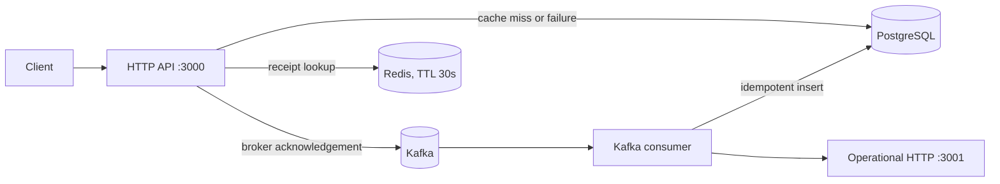

# CaseCellShop backend foundation

Two independently runnable NestJS applications: an HTTP API and a Kafka consumer. This repository currently demonstrates the infrastructure and module boundaries for the senior backend challenge. Product catalog, checkout, inventory, ERP integration, and the five conceptual answers are **not implemented yet**.

## Run it

Requires Node.js 24, npm 12.2.2, and Docker with Compose v2. The application database belongs to the storefront; no ERP database is accessed.

```bash
nvm use
npm install --global npm@12.2.2
npm ci
cp .env.example .env
npm run infra:up
npm run infra:init
npm run migration:run
```

In separate terminals:

```bash
npm run start:api:dev
npm run start:worker:dev
```

Alternatively, run everything in containers, including the explicit migration job:

```bash
docker compose up -d --build --wait api worker
```

Compose uses fixed local demonstration credentials and pinned image versions. PostgreSQL, Redis, Kafka, and HTTP ports bind to the host loopback interface. Data survives `docker compose down`. Use `docker compose down -v` only when you intend to discard local data.

Local apps and the migration CLI load `.env.local` first, then `.env`. Environment variables take precedence over both files. Set `ENV_FILE` to select a single explicit file. Tests ignore these application files. Configuration is validated before startup; credentials are never included in validation errors.

When switching from containerized apps to local development, run `docker compose stop api worker` to free ports 3000 and 3001. Keep the support services running with `npm run infra:up`.

VS Code workspace settings point to the repository's TypeScript compiler. If the
editor keeps stale diagnostics, select **TypeScript: Select TypeScript Version →
Use Workspace Version**, then run **TypeScript: Restart TS Server**.

Application code explicitly loads Node types. Tests use `test/tsconfig.json`,
which adds Jest globals, and Jest's transformer reads that same configuration.
`npm run typecheck` checks both projects. Modern Node resolution and explicit
relative alias paths replace the deprecated `baseUrl` and `node10` options;
application output remains CommonJS.

## Try the asynchronous flow

```bash
curl -i -X POST http://localhost:3000/demo/messages \
  -H 'Content-Type: application/json' \
  -H 'x-correlation-id: 4c79764b-416c-4c29-939c-48eb86649ac3' \
  -d '{"message":"hello"}'
```

The API returns `202` with `{ "eventId": "<uuid>", "status": "published" }` only after Kafka acknowledges publication. Use the returned ID:

```bash
curl -i http://localhost:3000/demo/messages/<eventId>
```

A `200` receipt contains `schemaVersion`, `eventId`, `correlationId`, `message`, `occurredAt`, and `receivedAt`. A `404` means the receipt is currently absent; retry briefly while the worker processes it. It does not distinguish an unknown ID from an event still in flight.

The message must contain a non-whitespace character and have at most 500 characters. Unexpected request properties and invalid UUID path parameters return `400`. Publication failures return `503`; unexpected server errors return `500`. HTTP errors contain `statusCode`, `error`, `message`, and `correlationId`. A valid UUID `x-correlation-id` is propagated into the event and receipt; absent or invalid values are replaced. Every API response echoes the effective ID in its header.

Swagger UI: [localhost:3000/api-docs](http://localhost:3000/api-docs). Its JSON is at `/api-docs-json`. The committed [OpenAPI contract](openapi.json) can be regenerated without starting any support services:

```bash
npm run openapi:export
npx prettier --write openapi.json
```

## Architecture



- `apps/api`: HTTP validation, status codes, Swagger, and composition.
- `apps/worker`: Kafka consumer lifecycle and operational health routes. It exposes no demo business endpoints.
- `libs/contracts`: versioned event schema and receipt types; no HTTP or ORM dependencies.
- `libs/demo`: focused publish, receive, and read use cases; contracts for publisher, repository, and cache; concrete adapters and explicit module wiring.
- `libs/platform`: validated configuration, shared database schema registration, Kafka/Redis connections, logging, and health checks.

This is a Nest CLI monorepo with one dependency graph and a deliberately shared storefront database. The apps have separate entry points and can scale independently, but they are not independently owned microservices. Shared libraries prevent duplicated business rules. Framework and transport code stays outside event contracts; use cases depend on small injected ports. There are no generic base repositories or empty future feature modules.

### Delivery and consistency decisions

The API writes directly to Kafka and does not write an order or receipt first. This demo therefore has no database/message dual write. A future checkout must add an atomic order/reservation/outbox transaction rather than copying this publisher as a checkout implementation.

The worker uses KafkaJS directly inside a Nest lifecycle provider. This keeps subscription configuration, processing completion, and shutdown explicit without adding a second messaging abstraction. Kafka offsets are resolved after the awaited handler succeeds. PostgreSQL's primary key and `ON CONFLICT (event_id) DO NOTHING` make repeated deliveries harmless, including a crash after insert but before offset commit. This is at-least-once processing with an idempotent database effect, not exactly-once delivery.

HTTP publishing has no idempotency key. An acknowledgement timeout can return `503` even if Kafka stored the event; a client retry generates another event ID. Invalid events and database errors fail the handler and can block a partition or require a worker restart. Bounded retries, DLQ, reconciliation, and HTTP idempotency are intentionally deferred to checkout work.

Receipts are immutable, so Redis uses a fixed 30-second TTL with no invalidation requirement. Missing receipts are never cached. Redis connection errors, malformed values, and one-second command timeouts fall back to PostgreSQL. There is no catalog caching or stampede prevention claim in this phase.

### Database lifecycle

Both apps use the same TypeORM connection configuration and receipt schema. Schema synchronization and automatic startup migrations are disabled in every environment.

```bash
npm run migration:run
npm run migration:revert
```

The Compose migration service uses the build image with development tools; the runtime image contains only production dependencies. Future migrations should be reviewed and run as an explicit deployment step before starting compatible app versions.

## Health and logs

Both apps expose `/health/live` and `/health/ready`; the worker uses port 3001. Liveness only confirms the HTTP process responds. Readiness checks PostgreSQL and Kafka topic metadata, and the worker also requires its consumer to join the group. It returns `503` when required dependencies fail or the app is shutting down. `/health/cache` reports Redis availability independently; a Redis failure does not make the API unready.

Logs are JSON with timestamp, app, level, and event name. HTTP completion logs include correlation ID, method, path, status, and duration. Publication and consumption logs include event and correlation IDs. Payloads and connection credentials are not logged. Both applications enable Nest shutdown hooks and close consumers, producers, admin clients, Redis clients, HTTP servers, and database pools.

To investigate a missing receipt, search API/worker logs by `eventId` or `correlationId`, check both readiness endpoints, inspect consumer failures, and confirm the applications use the same topic and database. Do not replay production purchases using this demonstration endpoint.

Metrics, distributed tracing, dashboards, SLOs, and full operational runbooks remain part of the challenge implementation; correlation propagation here is not a tracing implementation.

## Verification

Dependency updates remove all reported production, critical, high, and moderate
vulnerabilities. Nine low-severity development-tool findings remain from one
unpatched `deepmerge` advisory. The [dependency review](docs/dependencies.md)
records the updates, scoped overrides, and install-script policy.

See the [verification record](docs/verification.md) for completed checks and the
exact coverage of the live integration and container checks.

```bash
npm run lint
npm run format:check
npm run typecheck
npm test
npm run test:cov
npm run build
npm run start:api:prod
# Separate terminal:
npm run start:worker:prod
```

Unit tests require no support services. They cover contract and configuration validation, HTTP success/error responses, broker acknowledgement, persistence failures, cache lookup behavior, and Redis fallback.

For real-service integration tests:

```bash
npm run infra:up
cp .env.test.example .env.test.local
npm run test:integration
```

The PostgreSQL initialization script creates `casecellshop_test` on a fresh volume. If reusing a volume created before this script existed, create that database once with `docker compose exec postgres createdb -U casecellshop casecellshop_test`.

Tests load only `.env.test.local` (or `TEST_ENV_FILE`), require a local database ending in `_test` and Redis database `/1`, and create a unique Kafka topic/group per run. They migrate the dedicated test database and delete only their own receipts, cache keys, topic, and consumer group. They bootstrap two Nest application contexts inside Jest and exercise the real HTTP/Kafka/database/cache flow, duplicate delivery, cache hits/TTL, and reads after the API loses its Redis connection. The Compose smoke check starts the apps in separate containers. All resources close without Jest's forced-exit option.

CI checks formatting, lint, types, both builds, unit tests, generated OpenAPI, real-service integration tests, and container readiness. Running Docker-dependent checks requires a working Docker daemon; no skipped integration suite should be reported as a pass.

## Next challenge increments

1. Catalog cache policy, TTL/invalidation, fallback, and stampede prevention.
2. Atomic stock reservation and HTTP idempotency with order persistence.
3. Transactional outbox, ERP simulation, bounded retries, DLQ, and reconciliation.
4. Business metrics, trace propagation, SLOs, alerts, runbooks, and conceptual answers.

See [PROMPTS.md](PROMPTS.md) for AI usage and review decisions, and [the challenge](casecellshop_senior_backend_challenge.md) for the complete acceptance criteria.
